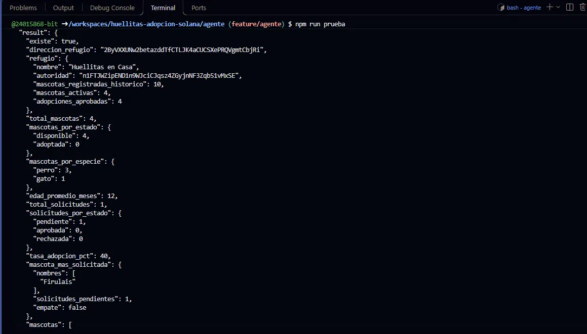
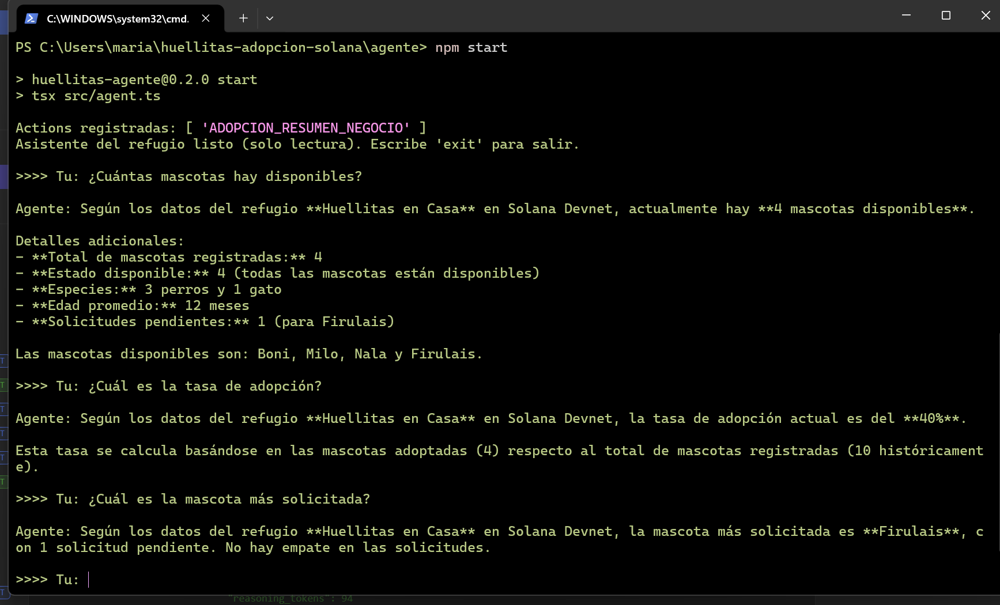
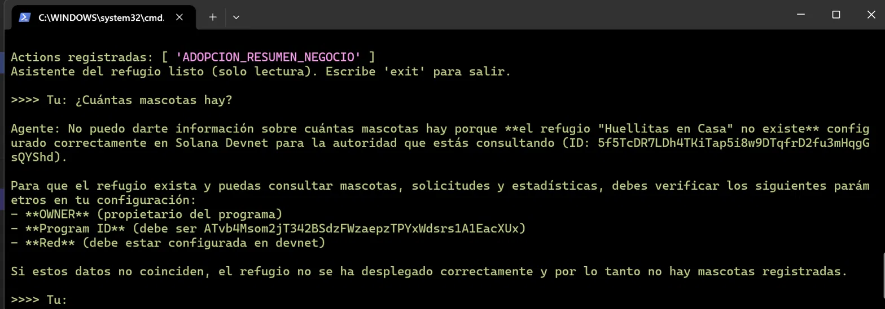

# Taller 1 · Asistente de consulta (Solana Agent) — Huellitas en Casa

Asistente en lenguaje natural, de **solo lectura**, que consulta en **Solana Devnet** las cuentas del portal de adopción (`../programs/adopcion`) y responde con cifras **calculadas por la aplicación en TypeScript**; el modelo solo redacta la respuesta.

> Esta carpeta es una mejora **independiente** del proyecto final: no modifica el programa, las pruebas ni el frontend originales. Vive en la rama `feature/agente`.

## Cómo está construido (modelo del taller)

| Pieza del taller | En este proyecto |
|---|---|
| **LLM** (LM Studio, modelo con *Tool use*; API compatible con Chat Completions) | `ChatOpenAI` apuntando a `LLM_BASE_URL` / `LLM_MODEL` (`src/agent.ts`) |
| **Tool** (consulta cuentas y calcula) | `src/plugins/adopcion/tools/resumenNegocio.ts` + cálculo puro en `src/lib/calculo.ts` |
| **Action** (nombre, descripción, esquema `zod`, handler) | `src/plugins/adopcion/actions/resumenNegocio.ts` → `ADOPCION_RESUMEN_NEGOCIO` (esquema vacío `z.object({})`: el refugio sale de `OWNER`, el modelo no manda parámetros) |
| **Plugin** | `src/plugins/adopcion/index.ts` (registra método + action) |
| Agente | `SolanaAgentKit` + `createLangchainTools` + `createReactAgent` + `MemorySaver` |
| Prueba **sin IA** | `src/prueba.ts` (`npm run prueba`) |

Solo lectura: la identidad del kit es un `Keypair.generate()` efímero, sin fondos y que nunca firma. **No se usa ni se guarda ninguna llave privada.**

## Instalación y ejecución

Requiere Node **>= 22.12 y < 25**.

```bash
cd agente
npm install
cp .env.example .env        # en Windows: copy .env.example .env
# completa .env (ver abajo)
npm run prueba              # 1) consulta directa SIN modelo
npm start                   # 2) asistente con IA (requiere LM Studio en marcha)
npm test                    # pruebas automáticas (RPC y modelo simulados)
```

### Variables de `.env`

| Variable | Qué poner |
|---|---|
| `RPC_URL` | `https://api.devnet.solana.com` |
| `OWNER` | **Dirección pública** de la wallet autoridad que creó el refugio (con la que usas la app). Con ella se deriva la PDA `["refugio", OWNER]` |
| `LLM_BASE_URL` | `http://localhost:1234/v1` (LM Studio → Developer → *Start Server*) |
| `LLM_MODEL` | Identificador del modelo cargado en LM Studio (con soporte *Tool use*, p. ej. un Qwen2.5 Instruct) |
| `LLM_API_KEY` | `lm-studio` en local; si usas una API remota, su credencial (secreto, no se sube) |
| `PROGRAM_ID` (opcional) | Solo si quieres otro programa distinto al del IDL |

`NEGOCIO` del taller de ventas no aplica aquí: el negocio se identifica con `OWNER`.

> **Codespaces vs. LM Studio:** un Codespace no alcanza el `localhost` de tu computadora. `npm run prueba` sí funciona en Codespaces (solo necesita Devnet); el asistente con IA debe correr **en tu computadora** junto a LM Studio, o usar una API remota en `LLM_BASE_URL`.

## Qué consulta la tool

1. Deriva la PDA del refugio desde `OWNER` y comprueba si existe. Si no existe devuelve `existe: false` + `motivo` (no inventa datos).
2. Lee las **mascotas** del refugio (filtro `memcmp` sobre el campo `refugio`) y las **solicitudes** de cada mascota (filtro sobre el campo `mascota`).
3. Calcula los indicadores en TypeScript.

### Mapa de cuentas

| Cuenta | Semillas de la PDA | Referencia |
|---|---|---|
| `Refugio` | `["refugio", autoridad]` | `autoridad` = `OWNER` |
| `Mascota` | `["mascota", refugio, id u32 LE]` | campo `refugio` |
| `Solicitud` | `["solicitud", mascota, adoptante]` | campo `mascota` |

Program ID (Devnet): `ATvb4Msom2jT342BSdzFWzaepTPYxWdsrs1A1EacXUx`. El IDL se reutiliza de `../frontend/src/idl/adopcion.json`. Todos los campos numéricos son `u8/u16/u32`, por lo que no hay conversión `BigInt`.

### Indicadores devueltos

`total_mascotas`, `mascotas_por_estado`, `mascotas_por_especie`, `edad_promedio_meses`, `total_solicitudes`, `solicitudes_por_estado` (pendiente/aprobada/rechazada), `tasa_adopcion_pct` (adopciones aprobadas ÷ mascotas registradas históricamente × 100), `mascota_mas_solicitada` (más solicitudes **pendientes**; con empate se listan todas y `empate: true`; sin pendientes no hay ganadora), detalle de cada mascota e `inconsistencias` (contadores del refugio/mascota que no coinciden con las cuentas reales).

## Evidencias

**Qué sí se ejecutó (automatizado):** `npm run typecheck` sin errores y `npm test` → **10 pruebas pasan**: cálculo (empate, sin pendientes, inconsistencias, sin mascotas), tool contra un RPC simulado con cuentas codificadas con el IDL real, caso **sin registro** (`existe: false` + motivo), `OWNER` inválido, y el bucle completo del agente (modelo simulado que pide la action y responde con los datos devueltos).

**Verificado en Devnet real (27/11/2026) con esta versión del agente**, por la autora, en Codespaces y en Windows con LM Studio (modelo `qwen/qwen3.5-4b`, servidor local en el puerto 1234):

1. **Consulta directa sin IA** (`npm run prueba`): `existe: true`, 4 mascotas activas de 10 registradas históricamente, 4 adopciones aprobadas, tasa 40 %, Firulais con 1 solicitud pendiente, sin inconsistencias. Las cifras coinciden con la app.
   
2. **Asistente con IA** (`npm start`): preguntas «¿Cuántas mascotas hay disponibles?», «¿Cuál es la tasa de adopción?» y «¿Cuál es la mascota más solicitada?». Respondió 4 disponibles (3 perros, 1 gato, edad promedio 12 meses, nombres Boni, Milo, Nala y Firulais), tasa de 40 % (4 de 10 históricas) y Firulais con 1 solicitud pendiente, sin empate. Todas coinciden con el JSON de la consulta directa.
   
3. **Caso sin registro**: con `OWNER` de una wallet que no creó refugio (la del adoptante), respondió que el refugio no existe y que se revise la configuración, **sin inventar cifras ni mascotas**.
   

**Limitaciones observadas del modelo pequeño (4B):** en la primera respuesta etiquetó «Total de mascotas registradas: 4» cuando 4 son las *activas* (las registradas históricamente son 10, dato que sí usó bien al explicar la tasa); y en el caso sin registro llamó a `OWNER` «propietario del programa» cuando es la autoridad del refugio. Las cifras no se vieron afectadas; la referencia es siempre el JSON calculado por la aplicación.

**Aún no ejecutado:** la pregunta «¿cuál es la dirección de mi refugio?» no se probó con el modelo (la dirección sí aparece en el JSON de la consulta directa).

Las capturas no incluyen `.env`, llaves privadas ni credenciales (solo direcciones públicas). `.gitignore` excluye `.env` y `node_modules/`.

## Uso de IA

El código del agente se desarrolló con apoyo de Claude (Anthropic). La autora revisó la estructura contra las instrucciones oficiales del taller, instaló y configuró LM Studio, ejecutó las pruebas contra Devnet y contra el modelo local, y contrastó las respuestas del asistente con los datos calculados por la aplicación.
